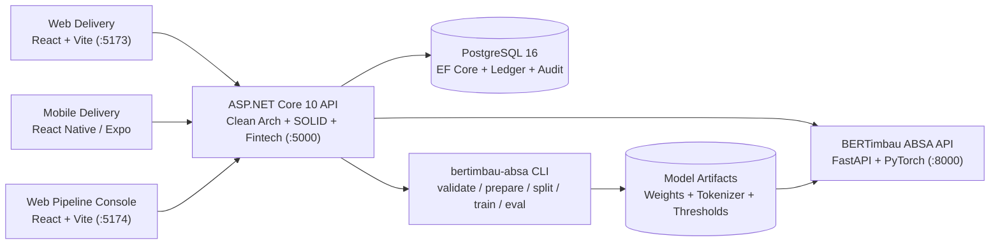
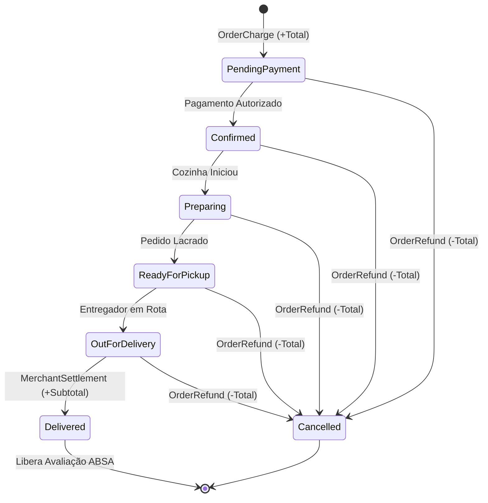
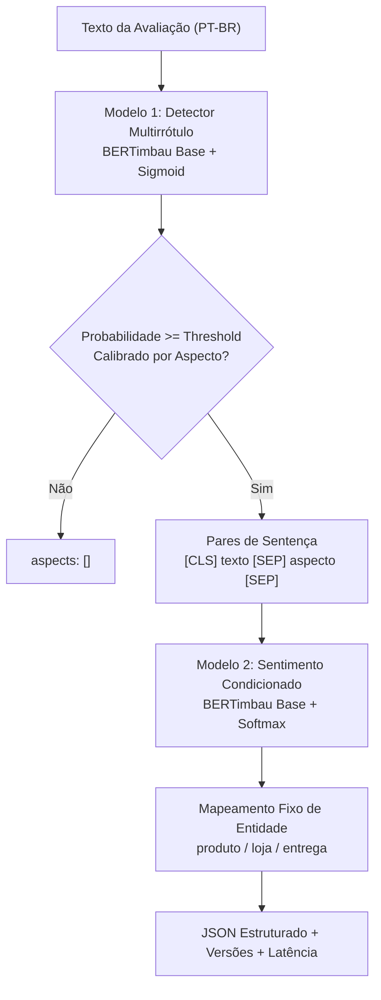

# YourFood.AI — Plataforma de Delivery Fintech & Pipeline BERTimbau ABSA

<p align="center">
  
  
  
  
  
  
  
  
</p>

<p align="center">
  <strong>Ecossistema completo de Delivery (Web + Mobile) construído sob arquitetura Fintech para coletar avaliações reais de pedidos e alimentar ponta a ponta um pipeline de Aspect-Based Sentiment Analysis (ABSA) com BERTimbau em Português Brasileiro, acompanhado de um Console Web MLOps independente para execução do pipeline e inferência dos modelos.</strong>
</p>

---

## Sumário

- [Visão Geral](#-visão-geral)
- [Arquitetura da Plataforma](#-arquitetura-da-plataforma)
- [Máquina de Estados de Pedidos & Ledger Fintech](#-máquina-de-estados-de-pedidos--ledger-fintech)
- [Arquitetura do Pipeline BERTimbau ABSA](#-arquitetura-do-pipeline-bertimbau-absa)
- [Taxonomia Oficial (12 Aspectos)](#-taxonomia-oficial-12-aspectos)
- [Princípios de Engenharia e Segurança](#-princípios-de-engenharia-e-segurança)
- [Estrutura do Monorepo](#-estrutura-do-monorepo)
- [Catálogo de Endpoints REST](#-catálogo-de-endpoints-rest)
- [Execução Rápida com Docker Compose](#-execução-rápida-com-docker-compose)
- [Execução Local por Módulo](#-execução-local-por-módulo)
- [Contas de Demonstração (Seed Automático)](#-contas-de-demonstração-seed-automático)
- [Testes e Validação](#-testes-e-validação)
- [Licença](#-licença)

---

## Visão Geral

O **YourFood.AI** une duas frentes integradas em um único ecossistema:

1. **Aplicação de Delivery (Web Responsivo + Mobile + Backend ASP.NET Core)**
   - **Clientes (`Customer`)**: navegam por restaurantes e cardápios com filtros de categoria e busca, montam sacola com checkout idempotente (incluindo barra flutuante de sacola em telas mobile), acompanham pedidos em tempo real com barra de progresso e máquina de estados, e enviam avaliações pós-entrega (nota interativa de 1 a 5 estrelas, texto livre e destaques opcionais da taxonomia oficial).
   - **Donos de Restaurantes (`StoreOwner`)**: visualizam KPIs operacionais (pedidos ativos, faturamento bruto do ledger e nota média), cadastram/gerenciam lojas e itens de cardápio, avançam o estado dos pedidos com extrato contábil (`LedgerEntry`) e acompanham a percepção dos clientes por aspecto.
2. **Sistema Web Separado de MLOps & Inferência (`web-pipeline-console` + `bertimbau-absa`)**
   - **Administradores MLOps (`Admin`)**: monitoram a saúde da API BERTimbau e a distribuição de sentimentos por entidade/aspecto com barras proporcionais, exportam avaliações do PostgreSQL em `.jsonl` / `.csv`, revisam conflitos (`requires_review`), executam as etapas do pipeline `bertimbau-absa` (`export`, `validate`, `prepare`, `split`, `train`, `evaluate`, `export_models`) com visualização de logs/relatórios JSON, e rodam inferência individual, em lote ou diagnóstica com medidores de confiança.

---

## Arquitetura da Plataforma



| Módulo | Diretório | Stack Principal | Porta Padrão |
|---|---|---|---|
| **Backend API** | [`backend/`](./backend) | ASP.NET Core 10, EF Core 9, Npgsql, JWT/OAuth2, Swagger, xUnit | `:5000` |
| **Delivery Web** | [`web-delivery/`](./web-delivery) | React 19, Vite 6, TypeScript | `:5173` |
| **Delivery Mobile** | [`mobile-delivery/`](./mobile-delivery) | React Native, Expo 52, TypeScript, AsyncStorage | Expo Dev |
| **Console MLOps Web** | [`web-pipeline-console/`](./web-pipeline-console) | React 19, Vite 6, TypeScript | `:5174` |
| **Pipeline ML & API** | [`bertimbau-absa/`](./bertimbau-absa) | Python 3.11+, PyTorch, Transformers (BERTimbau), FastAPI, pytest | `:8000` |
| **Banco de Dados** | Docker Service `postgres` | PostgreSQL 16 Alpine | `:5432` |

---

## Máquina de Estados de Pedidos & Ledger Fintech

O tracking de pedidos é governado por uma máquina de estados determinística no domínio ([OrderEntities.cs](./backend/src/YourFood.Domain/Entities/OrderEntities.cs)), registrando histórico imutável de transições (`OrderStateTransition`) e lançamentos financeiros (`LedgerEntry`) com precisão monetária `decimal(18,2)`:



---

## Arquitetura do Pipeline BERTimbau ABSA

Sem uso de LLMs em treinamento ou inferência — determinístico, versionado e preparado para persistência analítica e motores de recomendação:



- **Modelo 1 (`AspectDetector`)**: 12 saídas independentes (`BCEWithLogitsLoss` + `pos_weight` sobre o treino) com calibração individual de thresholds F1 (`0.10` a `0.90`) na validação.
- **Modelo 2 (`SentimentClassifier`)**: Classificação em 3 classes (`positivo`, `negativo`, `neutro`) via `CrossEntropyLoss` ponderado, executado somente para os aspectos detectados pelo Modelo 1 (além de endpoint diagnóstico isolado).

---

## Taxonomia Oficial (12 Aspectos)

Centralizada e compartilhada entre o pipeline ML ([configs/taxonomy.yaml](./bertimbau-absa/configs/taxonomy.yaml)) e o domínio .NET ([AbsaTaxonomy.cs](./backend/src/YourFood.Domain/Constants/AbsaTaxonomy.cs)):

| Entidade | Código | Descrição | Exemplos |
|---|---|---|---|
| **produto** | `sabor` | Sabor, tempero e palatabilidade | delicioso, sem gosto, salgado |
| **produto** | `qualidade` | Qualidade geral ou dos ingredientes | ingredientes frescos, estragado |
| **produto** | `quantidade` | Tamanho, volume, porção ou recheio | porção pequena, veio bastante |
| **produto** | `temperatura` | Temperatura do alimento ou bebida | chegou frio, estava quente |
| **produto** | `aparencia` | Apresentação, montagem e visual | bem montado, veio destruído |
| **produto** | `preparo` | Execução e ponto de preparo | carne crua, massa queimada |
| **loja** | `atendimento` | Comunicação, suporte e tratamento | respondeu rápido, grosseiro |
| **loja** | `pedido_correto` | Correção e completude dos itens | faltou bebida, veio item errado |
| **loja** | `embalagem` | Proteção, lacre e acondicionamento | embalagem vazando, lacre violado |
| **loja** | `custo_beneficio` | Relação preço × experiência | caro pelo que oferece, vale o preço |
| **entrega** | `tempo_entrega` | Rapidez, demora ou atraso | chegou rápido, atrasou uma hora |
| **entrega** | `condicao_entrega` | Estado físico do pedido ao chegar | chegou amassado, bebida derramada |

---

## Princípios de Engenharia e Segurança

- **Clean Architecture & SOLID**: Separação rigorosa em `YourFood.Domain`, `YourFood.Application`, `YourFood.Infrastructure` e `YourFood.Api`.
- **Repository Pattern & Unit of Work**: Repositórios especializados (`IUserRepository`, `IStoreRepository`, `IOrderRepository`, `IReviewRepository`, `IPipelineJobRepository`, `IAuditLogRepository`, `IIdempotencyRepository`) com commits atômicos via `IUnitOfWork`.
- **Clean Code sem comentários**: Todo o código-fonte do backend, web delivery, mobile e console MLOps foi escrito com nomes autoexplicativos, métodos coesos e zero comentários.
- **Segurança JWT & OAuth2**:
  - Access Tokens JWT (HMAC-SHA256) + rotação e revogação de Refresh Tokens com hash SHA-256 em banco.
  - Fluxo **OAuth2 Authorization Code + PKCE** (`/api/v1/auth/oauth2/authorize` e `/api/v1/auth/oauth2/token`) e SSO externo (`/api/v1/auth/oauth2/external`).
  - RBAC estrito por perfil (`Customer`, `StoreOwner`, `Admin`).
- **Padrões Fintech**:
  - **Idempotência**: Middleware `Idempotency-Key` prevenindo criação duplicada de pedidos/avaliações com validação de hash SHA-256 do payload (`409 Conflict` em reuso divergente e replay seguro em retentativas).
  - **Trilha de Auditoria Imutável**: Tabela `AuditLogs` gravando ator, ação, entidade, `X-Correlation-ID` e hash SHA-256 de cada operação sensível.
  - **Rastreabilidade distribuída**: Cabeçalho `X-Correlation-ID` propagado do frontend até o backend .NET e a API FastAPI do BERTimbau.
  - **Privacidade (LGPD/PII)**: Logs do pipeline ABSA mascaram e-mails/telefones e omitem texto completo das avaliações por padrão.

---

## Estrutura do Monorepo

```text
YourFood.AI/
├── backend/                          # ASP.NET Core 10 + EF Core + PostgreSQL
│   ├── YourFood.slnx
│   ├── Dockerfile
│   ├── src/
│   │   ├── YourFood.Domain/          # Entidades, Enums, Taxonomia, Exceções, Interfaces de Repositório
│   │   ├── YourFood.Application/     # DTOs, Serviços de Aplicação, Portas Externas
│   │   ├── YourFood.Infrastructure/  # EF Core DbContext, Repositórios, Seeder, JWT/BCrypt, ABSA Client, CLI Runner
│   │   └── YourFood.Api/             # Controllers REST, Middlewares Fintech (Idempotency/Correlation/Exception), Program.cs
│   └── tests/YourFood.Tests/         # Testes xUnit (State Machine, Ledger, Conflitos ABSA, Exportação Canônica)
├── web-delivery/                     # App Web de Delivery (React + Vite + TS)
│   ├── Dockerfile
│   └── src/                          # Auth JWT/OAuth2, Fluxo Cliente, Portal do Restaurante
├── mobile-delivery/                  # App Mobile de Delivery (React Native + Expo + TS)
│   ├── App.tsx
│   └── src/                          # Auth, Fluxo Cliente e Fluxo Restaurante mobile
├── web-pipeline-console/             # Sistema Web Separado de MLOps & Inferência (React + Vite + TS)
│   ├── Dockerfile
│   └── src/                          # Telemetria, Pipeline Runner, Playground de Inferência, Anotação & Auditoria
├── bertimbau-absa/                   # Pipeline ML BERTimbau ABSA (Python + PyTorch + FastAPI)
│   ├── configs/                      # taxonomy.yaml, train_aspects.yaml, train_sentiment.yaml, api.yaml
│   ├── scripts/                      # validate, prepare, split, train_aspect_detector, train_sentiment_classifier, evaluate, export
│   ├── src/absa/                     # Modelos PyTorch, Datasets, Métricas, Inferência e API FastAPI
│   ├── tests/                        # 35 testes automatizados (unitários, integração e 12 casos linguísticos)
│   ├── requirements.txt              # Dependências completas (treinamento + testes)
│   ├── requirements-inference.txt    # Dependências enxutas de inferência para o container Docker
│   └── Dockerfile                    # Imagem enxuta com PyTorch CPU-only e usuário não-root
├── docker-compose.yml                # Orquestração completa dos 5 serviços
├── LICENSE
└── README.md
```

---

## Catálogo de Endpoints REST

### Autenticação & OAuth2 (`/api/v1/auth`)
- `POST /register` — Cadastro de usuário (`Customer`, `StoreOwner`, `Admin`)
- `POST /login` — Autenticação com retorno de Access Token JWT + Refresh Token
- `POST /refresh` — Rotação segura de Refresh Token
- `POST /oauth2/authorize` — Emissão de Authorization Code com suporte a PKCE (`code_challenge`)
- `POST /oauth2/token` — Troca de `authorization_code` (com verificação PKCE) ou `refresh_token` por JWT
- `POST /oauth2/external` — Login/vinculação via provedor OAuth2 externo (Google, GitHub)
- `GET /me` — Perfil autenticado

### Lojas e Cardápios (`/api/v1/stores`)
- `GET /` — Listagem com filtro por busca e categoria
- `GET /{storeId}` — Detalhes da loja e cardápio
- `GET /mine` — Lojas do comerciante autenticado (`StoreOwner`, `Admin`)
- `POST /` & `PUT /{storeId}` — Cadastro e atualização de estabelecimentos
- `POST /{storeId}/items` & `PUT /items/{menuItemId}` — Gestão de itens do cardápio

### Pedidos e Tracking por Estados (`/api/v1/orders`)
- `POST /` — Criação de pedido com suporte a `Idempotency-Key` e geração de `LedgerEntry`
- `GET /my` — Pedidos do cliente com linha do tempo de estados
- `GET /merchant` — Pedidos recebidos pelas lojas do comerciante
- `GET /{orderId}` — Detalhes completos com itens, histórico de estados e ledger
- `PATCH /{orderId}/status` — Transição validada na máquina de estados

### Coleta de Avaliações & Anotações ABSA (`/api/v1/reviews`)
- `POST /` — Submissão de avaliação em pedido entregue (com inferência opcional imediata e anotações)
- `GET /` — Listagem filtrável por loja, pendentes de inferência ou conflitos (`onlyFlagged`)
- `PUT /{reviewId}/annotations` — Edição de anotações ground-truth e resolução de conflitos
- `POST /{reviewId}/analyze` — Execução de inferência BERTimbau em avaliação específica
- `POST /analyze-batch` — Inferência em lote sobre avaliações pendentes (`Admin`)

### Orquestração do Pipeline & Inferência MLOps (`/api/v1/pipeline`)
- `GET /taxonomy` — Taxonomia oficial versionada
- `GET /health` — Saúde em tempo real da API FastAPI do BERTimbau
- `GET /analytics` — Métricas consolidadas por aspecto e entidade de negócio
- `POST /export` — Exportação canônica `.jsonl` ou `.csv` para `bertimbau-absa/data/raw/`
- `POST /jobs` & `GET /jobs` — Disparo e monitoramento dos scripts Python do pipeline
- `POST /inference/analyze` — Proxy de inferência completa (Modelo 1 + Modelo 2)
- `POST /inference/classify-sentiment` — Diagnóstico isolado do Modelo 2 por aspecto
- `GET /audit-logs` — Consulta à trilha de auditoria imutável (`Admin`)

---

## Execução Rápida com Docker Compose

Suba toda a infraestrutura integrada com um único comando:

```bash
docker compose up -d --build
```

Após a inicialização, acesse:

| Aplicação | URL |
|---|---|
| **Delivery Web (Cliente & Restaurante · Responsivo Mobile/Desktop)** | [http://localhost:5173](http://localhost:5173) |
| **Console Web de Pipeline & Inferência (MLOps Studio)** | [http://localhost:5174](http://localhost:5174) |
| **Backend ASP.NET Core Swagger UI** | [http://localhost:5000/swagger](http://localhost:5000/swagger) |
| **API BERTimbau ABSA (FastAPI Docs)** | [http://localhost:8000/docs](http://localhost:8000/docs) |

> **Notas sobre Docker e Inferência:**
> - As etapas de dados do pipeline (`Exportar Dataset`, `Validar`, `Preparar`, `Dividir` e `Preparação Completa`) executam nativamente a partir do **Console MLOps** dentro do container `backend-api`.
> - A imagem `absa-api` utiliza `requirements-inference.txt` com **PyTorch CPU-only** (sem bibliotecas de treino/CUDA na imagem final). Antes do primeiro treinamento dos pesos em `bertimbau-absa/artifacts/`, a API sobe normalmente em modo `online` e retorna HTTP `503` nos endpoints de inferência até que os artefatos treinados sejam exportados e o container `absa-api` reiniciado.

---

## Execução Local por Módulo

### 1. Banco PostgreSQL
```bash
docker compose up -d postgres
```

### 2. Backend ASP.NET Core 10
```bash
cd backend
dotnet test
dotnet run --project src/YourFood.Api
```

### 3. Delivery Web (React + Vite)
```bash
cd web-delivery
npm install
npm run dev
```

### 4. Delivery Mobile (React Native + Expo)
```bash
cd mobile-delivery
npm install
npm start
```
> Configure `EXPO_PUBLIC_API_URL` caso rode em dispositivo físico apontando para o IP local da máquina (ex.: `http://192.168.0.10:5000`). Em emulador Android, o padrão `http://10.0.2.2:5000` já funciona direto.

### 5. Console Web de Pipeline & Inferência (Sistema Separado)
```bash
cd web-pipeline-console
npm install
npm run dev
```

### 6. Pipeline BERTimbau ABSA (CLI & API FastAPI)
```bash
cd bertimbau-absa
pip install -r requirements.txt
pytest tests/ -v
uvicorn absa.api.main:app --host 0.0.0.0 --port 8000
```

---

## Contas de Demonstração (Seed Automático)

Na primeira execução, o [DatabaseSeeder.cs](./backend/src/YourFood.Infrastructure/Persistence/DatabaseSeeder.cs) cria automaticamente 3 usuários, 3 restaurantes (*Brasa & Blend Burger*, *Forno D'Oro Pizzaria* e *Kuro Sushi Lab*), cardápios completos, pedidos entregues e avaliações anotadas prontas para exportar e treinar:

| Perfil | E-mail | Senha | Sistema |
|---|---|---|---|
| **Cliente** | `customer@yourfood.ai` | `Customer@123` | `web-delivery` e `mobile-delivery` |
| **Dono de Restaurante** | `merchant@yourfood.ai` | `Merchant@123` | `web-delivery` e `mobile-delivery` |
| **Administrador MLOps** | `admin@yourfood.ai` | `Admin@123` | `web-pipeline-console` |

---

## Testes e Validação

| Módulo | Suíte / Comando | Status |
|---|---|---|
| **Backend (.NET 10)** | `cd backend && dotnet test` | 5/5 testes xUnit aprovados (State Machine, Ledger, Persistência de Transições, Conflitos, Exportação Canônica) |
| **Pipeline ML (Python)** | `cd bertimbau-absa && pytest tests/ -v` | 35/35 testes aprovados (unitários, API, E2E e 12 casos linguísticos) |
| **Delivery Web** | `cd web-delivery && npm run build` | TypeScript strict + Vite production bundle + layout mobile responsivo |
| **Pipeline Console Web** | `cd web-pipeline-console && npm run build` | TypeScript strict + Vite production bundle + layout mobile responsivo |
| **Delivery Mobile (RN)** | `cd mobile-delivery && npm run typecheck` | TypeScript strict verificado sem erros |
| **Docker Compose Stack** | `docker compose up -d --build` | 5 serviços em execução validados com smoke test (Orders PATCH + Pipeline `Export`/`FullDataPreparation` exit 0) |

---

## Licença

Distribuído sob a licença **MIT**. Consulte o arquivo [LICENSE](./LICENSE) para mais detalhes.
