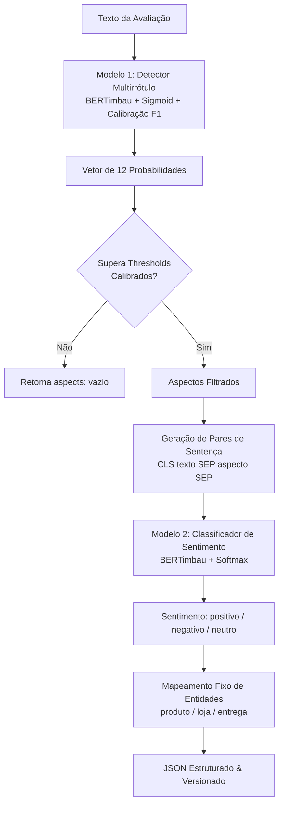

# YourFood.AI — Aspect-Based Sentiment Analysis (ABSA) Pipeline

<p align="center">
  
  
  
  
  
  
</p>

Pipeline de **Aspect-Based Sentiment Analysis (ABSA)** em português brasileiro baseado no modelo pré-treinado **BERTimbau Base** (`neuralmind/bert-base-portuguese-cased`).

O pipeline foi projetado para processar avaliações de pedidos de delivery de comida de ponta a ponta: recebe o texto livre do consumidor, identifica múltiplos aspectos específicos da experiência, classifica a polaridade de sentimento de cada aspecto e associa automaticamente a entidade de negócio correspondente (`produto`, `loja` ou `entrega`).

---

## Sumário

- [Visão Geral e Arquitetura](#-visão-geral-e-arquitetura)
- [Taxonomia Oficial do MVP](#-taxonomia-oficial-do-mvp)
- [Estrutura do Repositório](#-estrutura-do-repositório)
- [Instalação e Ambiente](#-instalação-e-ambiente)
- [Ciclo Completo de Dados](#-ciclo-completo-de-dados)
  - [1. Validação do Dataset](#1-validação-do-dataset)
  - [2. Preparação e Normalização](#2-preparação-e-normalização)
  - [3. Divisão sem Vazamento](#3-divisão-sem-vazamento)
- [Treinamento dos Modelos](#-treinamento-dos-modelos)
  - [Modelo 1: Detector de Aspectos](#modelo-1-detector-multirrótulo-de-aspectos)
  - [Modelo 2: Classificador de Sentimento](#modelo-2-classificador-de-sentimento-por-aspecto)
- [Avaliação Integrada do Pipeline](#-avaliação-integrada-do-pipeline)
- [API REST (FastAPI)](#-api-rest-fastapi)
  - [Endpoints e Exemplos](#endpoints-e-exemplos)
- [Execução com Docker](#-execução-com-docker)
- [Testes Automatizados](#-testes-automatizados)
- [Critérios para Novos Aspectos](#-critérios-para-inclusão-de-novos-aspectos)

---

## 🏗 Visão Geral e Arquitetura

O sistema emprega uma arquitetura desacoplada em dois estágios, garantindo inferência rápida, determinística e sem dependência de LLMs em produção:



### Modelo 1: Detector Multirrótulo de Aspectos
- **Backbone**: `neuralmind/bert-base-portuguese-cased`
- **Camada de saída**: Linear (12 saídas binárias independentes) + ativação `sigmoid`
- **Função de perda**: `BCEWithLogitsLoss` com ponderação `pos_weight` calculada exclusivamente no split de treino
- **Calibração**: Otimização independente de limiar (threshold) por aspecto no conjunto de validação para maximização de F1 (faixa `0.10` a `0.90`)

### Modelo 2: Classificador de Sentimento Condicionado ao Aspecto
- **Backbone**: `neuralmind/bert-base-portuguese-cased`
- **Formato de entrada**: Pares de sentenças pelo tokenizer do BERT:
  ```text
  [CLS] O hambúrguer estava bom, mas chegou frio. [SEP] temperatura [SEP]
  ```
- **Camada de saída**: Linear (3 saídas: `positivo`, `negativo`, `neutro`) + ativação `softmax`
- **Função de perda**: `CrossEntropyLoss` com balanceamento de pesos de classe

### Mapeamento Fixo de Entidades
A atribuição da entidade de negócio é feita por regras estritas e imutáveis da taxonomia, sem necessidade de inferência probabilística adicional.

---

## 📋 Taxonomia Oficial do MVP

A taxonomia oficial é mantida centralizada em `configs/taxonomy.yaml` (`food-reviews-taxonomy-v1`):

| Entidade | Código do Aspecto | Descrição | Exemplos |
|---|---|---|---|
| **produto** | `sabor` | Sabor, tempero e palatabilidade | delicioso, sem gosto, salgado, enjoativo |
| **produto** | `qualidade` | Qualidade geral ou dos ingredientes | ingredientes frescos, produto estragado, carne de baixa qualidade |
| **produto** | `quantidade` | Tamanho, volume, porção ou recheio | porção pequena, veio bastante, pouco recheio |
| **produto** | `temperatura` | Temperatura do alimento ou bebida | chegou frio, estava quente, sorvete derretido |
| **produto** | `aparencia` | Apresentação, montagem e aparência visual | bem montado, veio destruído, aparência ruim |
| **produto** | `preparo` | Execução e ponto de preparo | carne crua, massa queimada, ponto correto |
| **loja** | `atendimento` | Comunicação, suporte e tratamento | respondeu rápido, foi grosseiro, não respondeu |
| **loja** | `pedido_correto` | Correção e completude dos itens recebidos | faltou bebida, veio item errado, pedido completo |
| **loja** | `embalagem` | Proteção, lacre e acondicionamento | embalagem vazando, bem embalado, lacre violado |
| **loja** | `custo_beneficio` | Relação entre preço e experiência recebida | caro pelo que oferece, vale o preço |
| **entrega** | `tempo_entrega` | Rapidez, demora ou atraso na entrega | chegou rápido, atrasou uma hora |
| **entrega** | `condicao_entrega` | Estado físico do pedido ao chegar | chegou amassado, bebida derramada |

---

## 📁 Estrutura do Repositório

```text
bertimbau-absa/
├── configs/                      # Arquivos de configuração versionados
│   ├── taxonomy.yaml             # Taxonomia canônica, entidades e aspectos
│   ├── train_aspects.yaml        # Hiperparâmetros do Detector de Aspectos
│   ├── train_sentiment.yaml      # Hiperparâmetros do Classificador de Sentimento
│   └── api.yaml                  # Configurações do servidor FastAPI
├── data/
│   ├── raw/                      # Dados brutos de entrada (.jsonl / .csv)
│   ├── processed/                # Dados normalizados e agregados
│   └── splits/                   # Partições isoladas (train, val, test)
├── artifacts/                    # Modelos, tokenizers, thresholds e metadados
├── reports/                      # Relatórios de validação e avaliação
├── scripts/                      # Linha de comando para pipeline
│   ├── validate_dataset.py       # Validador de consistência e distribuição
│   ├── prepare_dataset.py        # Normalização e filtro de conflitos
│   ├── split_dataset.py          # Particionamento sem vazamento de review_id
│   ├── train_aspect_detector.py  # Treinamento e calibração do Modelo 1
│   ├── train_sentiment_classifier.py # Treinamento do Modelo 2
│   ├── evaluate_pipeline.py      # Avaliação integrada do pipeline completo
│   └── export_models.py          # Empacotamento de artefatos para produção
├── src/absa/                     # Pacote Python principal
│   ├── __init__.py
│   ├── config.py                 # Dataclasses de configuração
│   ├── taxonomy.py               # Singleton de taxonomia
│   ├── preprocessing.py          # Normalização textual e análise de truncamento
│   ├── datasets.py               # Manipulação de registros, vetores e hashes
│   ├── metrics.py                # F1 macro/micro, thresholds, matrizes e latência
│   ├── inference.py              # Motor de inferência desacoplado
│   ├── logging_config.py         # Logging estruturado e mascaramento de PII
│   ├── models/                   # Módulos PyTorch / Transformers
│   │   ├── aspect_detector.py
│   │   └── sentiment_classifier.py
│   └── api/                      # Camada REST FastAPI
│       ├── main.py
│       ├── routes.py
│       ├── schemas.py
│       └── dependencies.py
├── tests/                        # 35 testes automatizados (unit & integration)
├── Dockerfile                    # Container Docker multi-stage
├── docker-compose.yml            # Orquestração local
├── pyproject.toml                # Gerenciador de pacote e dependências
└── requirements.txt
```

---

## 🚀 Instalação e Ambiente

### Pré-requisitos
- Python 3.11+
- CUDA 11.8+ ou 12.0+ (opcional; suporte total a CPU com detecção automática)

### Passo a passo
```bash
# Entre na pasta do projeto
cd bertimbau-absa

# Crie e ative um ambiente virtual
python -m venv .venv
source .venv/bin/activate       # Linux/macOS
# ou no Windows:
# .venv\Scripts\activate

# Instale as dependências
pip install -r requirements.txt
pip install -e .

# Configure as variáveis de ambiente
cp .env.example .env
```

---

## 🔄 Ciclo Completo de Dados

O repositório inclui uma massa de dados de exemplo em `data/raw/sample_reviews.jsonl`.

### 1. Validação do Dataset
Executa validação estrutural, checa conformidade com a taxonomia, detecta divergências de texto para o mesmo `review_id`, identifica conflitos de polaridade e calcula riscos de desbalanceamento:
```bash
python scripts/validate_dataset.py --input data/raw/sample_reviews.jsonl --output reports/validation
```
Gera relatórios em `reports/validation/validation_report.json` e `reports/validation/validation_report.md`.

### 2. Preparação e Normalização
Normaliza espaçamentos e quebras de linha preservando acentuação, caixa e pontuação. Identifica e isola registros conflitantes em `reviews_flagged.jsonl`:
```bash
python scripts/prepare_dataset.py --input data/raw/sample_reviews.jsonl --output data/processed
```

### 3. Divisão sem Vazamento (70% / 15% / 15%)
Garante que todas as menções do mesmo `review_id` pertençam estritamente à mesma partição, priorizando agrupamento por `user_id` > `order_id` > `review_id` ou temporal:
```bash
python scripts/split_dataset.py --input data/processed/reviews.jsonl --output data/splits --seed 42
```
Gera `split_manifest.json` com os hashes SHA-256 e estatísticas de cada divisão.

---

## 🎯 Treinamento dos Modelos

### Modelo 1: Detector Multirrótulo de Aspectos
```bash
python scripts/train_aspect_detector.py --config configs/train_aspects.yaml
```
- Aplica Early Stopping avaliando Macro F1.
- Calcula os melhores limiares de decisão por aspecto (`thresholds.json`) sobre a validação.
- Exporta modelo, tokenizer, rótulos e metadados em `artifacts/aspect-detector/bertimbau-aspects-v1/`.

### Modelo 2: Classificador de Sentimento por Aspecto
```bash
python scripts/train_sentiment_classifier.py --config configs/train_sentiment.yaml
```
- Classifica sentimento em pares `[texto, aspecto]`.
- Aplica balanceamento de classes com `CrossEntropyLoss`.
- Salva o melhor modelo em `artifacts/sentiment-classifier/bertimbau-aspect-sentiment-v1/`.

---

## 📊 Avaliação Integrada do Pipeline

Avalia a propagação de erros de ponta a ponta sobre o conjunto de teste cego:
```bash
python scripts/evaluate_pipeline.py --input data/splits/test.jsonl --output reports/final
```

O relatório discrimina com clareza:
- **Precision, Recall e F1** de pares exatos `(aspecto, sentimento)`.
- **Taxa de avaliações 100% corretas**.
- **Erros de detecção de aspecto** (falsos positivos e falsos negativos por categoria).
- **Erros de sentimento** quando o aspecto foi corretamente detectado.
- **Perfil de latência** (média, p50, p95 e p99 em milissegundos).

---

## 🌐 API REST (FastAPI)

Inicie o servidor de inferência:
```bash
uvicorn absa.api.main:app --host 0.0.0.0 --port 8000 --reload
```

Acesse a documentação interativa:
- Swagger UI: [http://localhost:8000/docs](http://localhost:8000/docs)
- ReDoc: [http://localhost:8000/redoc](http://localhost:8000/redoc)

### Endpoints e Exemplos

#### 1. Verificação de Saúde (`GET /health`)
```bash
curl -X GET http://localhost:8000/health
```
```json
{
  "status": "ok",
  "aspectModelLoaded": true,
  "sentimentModelLoaded": true
}
```

#### 2. Análise de Avaliação (`POST /api/v1/reviews/analyze`)
```bash
curl -X POST http://localhost:8000/api/v1/reviews/analyze \
  -H "Content-Type: application/json" \
  -d '{
    "reviewId": "9001",
    "text": "O hambúrguer estava muito bom, mas chegou frio e a entrega atrasou mais de uma hora."
  }'
```

**Resposta:**
```json
{
  "reviewId": "9001",
  "text": "O hambúrguer estava muito bom, mas chegou frio e a entrega atrasou mais de uma hora.",
  "aspects": [
    {
      "entity": "produto",
      "aspect": "sabor",
      "aspectProbability": 0.9621,
      "sentiment": "positivo",
      "sentimentProbability": 0.9412
    },
    {
      "entity": "produto",
      "aspect": "temperatura",
      "aspectProbability": 0.9184,
      "sentiment": "negativo",
      "sentimentProbability": 0.9733
    },
    {
      "entity": "entrega",
      "aspect": "tempo_entrega",
      "aspectProbability": 0.9345,
      "sentiment": "negativo",
      "sentimentProbability": 0.9589
    }
  ],
  "modelVersions": {
    "aspectDetector": "bertimbau-aspects-v1",
    "sentimentClassifier": "bertimbau-aspect-sentiment-v1",
    "taxonomy": "food-reviews-taxonomy-v1"
  },
  "processingTimeMs": 58.4
}
```

*Caso a avaliação não mencione nenhum aspecto (ex: `"Nota 1, não gostei"`), o campo `aspects` retorna uma lista vazia `[]` conforme especificação.*

#### 3. Análise em Lote (`POST /api/v1/reviews/analyze-batch`)
Permite submeter uma lista de avaliações em uma única chamada HTTP, respeitando o limite configurável de lote (`MAX_BATCH_SIZE=32`).

#### 4. Diagnóstico de Sentimento Condicionado (`POST /api/v1/reviews/classify-sentiment`)
Endpoint de diagnóstico para teste isolado do Modelo 2:
```bash
curl -X POST http://localhost:8000/api/v1/reviews/classify-sentiment \
  -H "Content-Type: application/json" \
  -d '{
    "text": "A pizza veio totalmente fria.",
    "aspect": "temperatura"
  }'
```
*Aspectos fora da taxonomia oficial são rejeitados com código HTTP 422.*

---

## 🐳 Execução com Docker

O projeto inclui um container otimizado com usuário não-root e healthcheck nativo:

```bash
# Construção e inicialização via Docker Compose
docker compose up -d --build

# Verificação dos logs
docker compose logs -f absa-api

# Teste de saúde
curl -f http://localhost:8000/health
```

---

## 🧪 Testes Automatizados

A suíte conta com **35 testes automatizados** cobrindo 100% dos requisitos funcionais, unitários, de integração e linguísticos:

```bash
pytest tests/ -v
```

### Casos Linguísticos Cobertos:
- ✅ Avaliações positivas diretas (`Gostei muito do sabor.`)
- ✅ Negações preservadas (`Não estava frio.`, `Não demorou nada.`)
- ✅ Múltiplos aspectos com polaridades divergentes (`Veio rápido, mas a embalagem estava aberta.`)
- ✅ Ausência correta de aspectos (`Nota 1, não gostei.`)
- ✅ Preservação de erros ortográficos e gírias populares (`x-burgue tava mto bom e chego rapido!`)
- ✅ Avaliações contendo exclusivamente emojis (`🍕😋❤️`)
- ✅ Rejeição de avaliações em branco ou compostas apenas de espaços

---

## 🔒 Segurança, Privacidade e Observabilidade

- **Proteção de Dados Pessoais (PII)**: Expressões regulares filtram e mascaram endereços de e-mail e telefones antes de qualquer saída de log.
- **Privacidade de Texto**: O texto completo da avaliação não é logado em produção por padrão (`LOG_FULL_TEXT=false`).
- **Rastreabilidade**: Middleware injeta e propaga cabeçalho `X-Correlation-ID` em todas as requisições.
- **Métricas**: Tempo de resposta medido em microssegundos e exposto no header `X-Response-Time-Ms`.

---

## 📌 Critérios para Inclusão de Novos Aspectos

Para preservar a estabilidade da taxonomia e do recomendador downstream, novos aspectos só devem ser adicionados mediante:
1. Utilidade comprovada para a operação do marketplace ou recomendador;
2. Definição disjunta e sem sobreposição com os 12 aspectos do MVP;
3. Volume mínimo de **200 exemplos anotados** para experimentação e **500 exemplos** para produção;
4. Distribuição balanceada de polaridades (`positivo`, `negativo` e `neutro`);
5. Validação em conjunto de teste sem degradação do Macro F1 das classes vigentes.

---

## 📄 Licença

Distribuído sob a licença MIT. Consulte `LICENSE` para mais detalhes.
